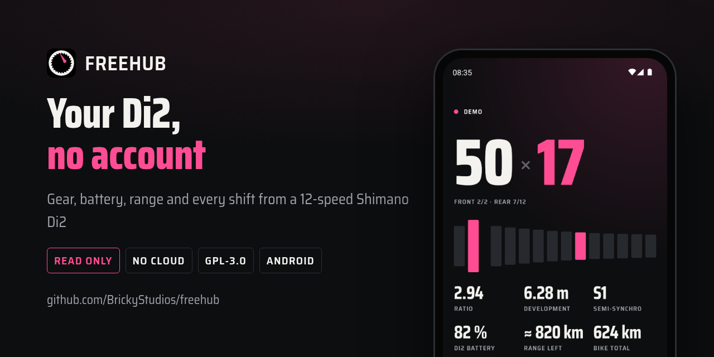
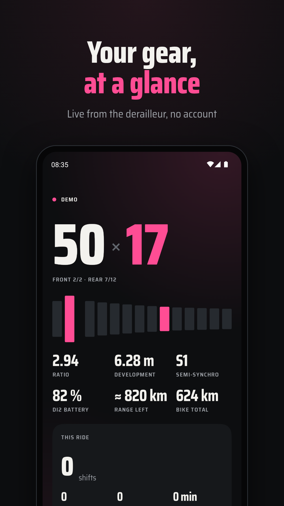
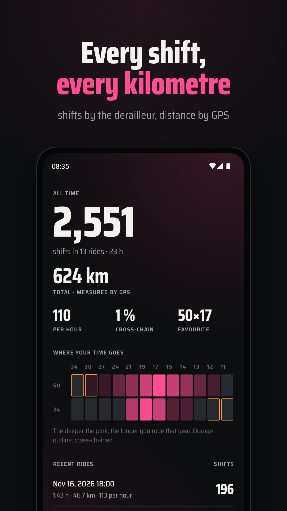
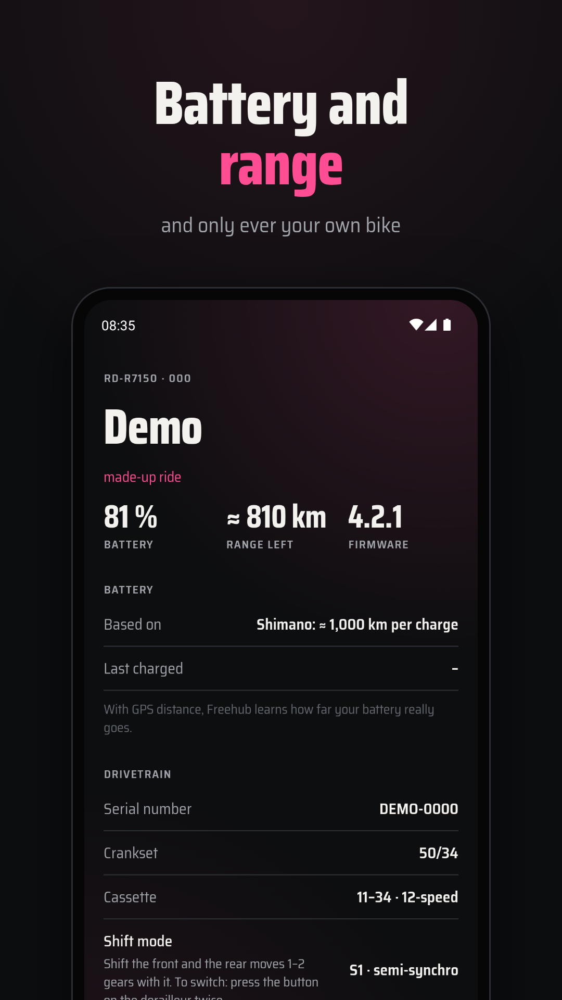
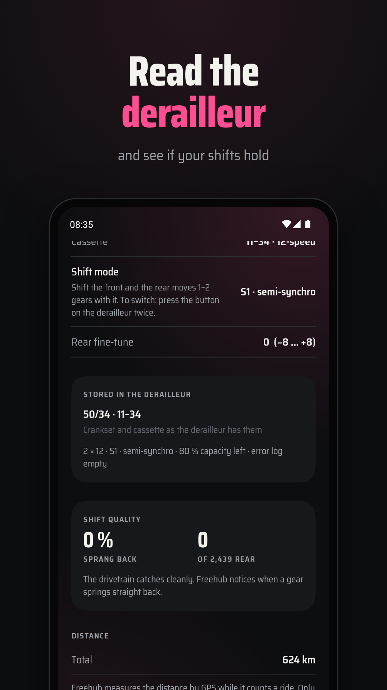

<div align="center">



# Freehub: Shimano Di2 app for Android without an account

[](https://github.com/BrickyStudios/freehub)

[](https://developer.android.com/compose)
[](PROTOCOL.md)
[](https://github.com/BrickyStudios/freehub/commits/main)
[](https://github.com/BrickyStudios/freehub/stargazers)
[](LICENSE)

**Gear, battery range, distance and every shift, read live from a 12-speed Shimano Di2 rear derailleur. No SHIMANO ID, no cloud, no tracking.**

</div>

Shimano's E-TUBE PROJECT app asks you to sign in with a SHIMANO ID before it shows anything. Freehub connects to the rear derailleur over Bluetooth, reads what the derailleur already broadcasts to bike computers, and keeps every number on your phone.

|  |  |  |  |
|---|---|---|---|

## What it shows

- **The gear you are in**, as teeth (50 × 17) and as positions (front 2/2, rear 7/12). The app reads chainrings and cassette from the derailleur. If it reports a pattern the app does not know, or the wrong one, pick yours under Bike → Drivetrain.
- **Battery** of the Di2 system in percent, with the **range left in km** and when you last charged. The range starts from Shimano's figure (about 1,000 km per charge) and learns your real consumption from the distance Freehub measures. At 20 % and again at 10 % a notification tells you how far it still goes, because a flat Di2 stops shifting.
- **Distance by GPS**, per ride and in total. The derailleur measures none, so Freehub uses the phone's own GPS while it counts a ride (no Google services needed). Only the distance is stored, never the route.
- **Every shift, counted.** A multi-shift across three cogs counts as three. Per ride and all time, rear and front apart, plus shifts per hour.
- **Where your time goes**: a heatmap of chainring × cog. Cross-chained combinations have an orange outline, and the share of time you spent in them is on top.
- **Ratio and development** (metres per crank turn) for your tyre size.
- **Shift mode** in plain words: manual, S1 (semi-synchro at the factory setting: shift the front and the rear follows) or S2 (synchro: shift the rear only, the front follows). Two presses on the button of the rear derailleur switch to the next one; Freehub says so next to the mode. Also the rear fine-tune level, firmware and serial number.
- **A photo of your bike** at the top of the Bike tab, picked from your gallery. It stays on the phone.
- **What the derailleur has stored about itself**, read the way E-TUBE reads it: the crankset and cassette it was set up with, the shift mode, the charge left and whether the error log has entries. Press the button on the back of the derailleur, tap Read, wait half a minute. If the derailleur was set up in E-TUBE, one tap takes its teeth over; if it never was, Freehub tells you that no teeth are stored.
- **Shift quality.** A shift that goes one cog and springs straight back did not hold. Freehub counts those and, after 60 rear shifts, tells you whether the drivetrain catches cleanly or which way to try the fine-tune. It never changes the adjustment itself.
- **D-Fly buttons**: press one of the extra buttons on the hoods and the app shows which channel arrived.
- **A tick for every cog.** While the app is open, each shift gives a short buzz per cog, like the pawls of a freehub clicking over the ratchet. You can switch it off.
- **English or German**, whatever language your phone runs.
- **Your bikes only.** You pair a derailleur once from a list of those in range, nearest first. From then on Freehub connects to paired derailleurs only, so a second bike of the same model next to yours (a brother's, a friend's) is never touched. Several bikes each keep their own rides, distance, battery log, crankset, cassette and tyre; the screens follow whichever bike wakes up.
- **Swipe between the tabs**, or tap the glass bar at the bottom.
- **A setup on first start** that walks through Bluetooth, connecting, crankset and cassette, auto start and GPS, so everything works from the first ride. It runs again from Bike → Settings.

With "keep counting with the screen off" on, a notification holds the connection while the phone sits in your jersey pocket. The ride ends ten minutes after the derailleur goes to sleep.

With "start when the derailleur wakes up" on (Android 12 or newer), Freehub does not need to be open at all: Android watches for the derailleur and starts the counting as soon as you click a shifter. You pick your derailleur once in Android's own list.

The demo mode plays a made-up ride and twelve earlier rides, so you can try the app without a Di2. Your real numbers stay untouched.

**Developer options** (Bike → Settings) log every Bluetooth packet to and from the derailleur and read every value once. The capture is a text file you can share, instead of setting up Android's HCI log. It contains your derailleur's serial number, so send it privately. They also hold one test write, switching the shift mode between manual and synchronized; it is not confirmed on a bike yet.

## Which bikes

Freehub talks to the rear derailleur of Shimano's 12-speed wireless Di2 groups:

| Group | Rear derailleur | Status |
|---|---|---|
| 105 Di2 R7100 | RD-R7150 | tested on a real bike |
| Ultegra Di2 R8100 | RD-R8150 | same protocol, untested |
| Dura-Ace Di2 R9200 | RD-R9250 | same protocol, untested |
| GRX Di2 RX820 | RD-RX825 | same protocol, untested |

If yours works (or does not), please open an issue with the model name the app shows. 11-speed Di2 needs Shimano's separate EW-WU111 wireless unit and has not been tried.

## Install

1. Download [`Freehub.apk`](https://github.com/BrickyStudios/freehub/releases/latest/download/Freehub.apk) from the latest release.
2. Open it on your phone and allow the install.
3. Start Freehub. A short setup walks through Bluetooth, pairing your bike (click a shifter once to wake the derailleur), crankset and cassette, auto start and GPS.

Android 8.0 or newer, no Google services needed. Updates come through the app (switch it off under Bike → Settings) or through [Obtainium](https://github.com/ImranR98/Obtainium) with this repository's URL.

## Privacy

- The only connections are Bluetooth to your derailleur and, if update checks are on, one request to GitHub's release API at start.
- GPS runs only while a ride is counted. Freehub keeps the distance, never a position or a route.
- Rides and counters live in the app's private storage. Android backup and device transfer are switched off for them.
- No account, no SHIMANO ID, no analytics, no ads.

## How it works

The derailleur advertises a Shimano service (`0x18EF`, "Shimano Bicycle Information") that bike computers subscribe to. Every gear report there carries the shift mode, both positions, the fine-tune levels and pattern numbers for the chainrings and the cassette. Freehub subscribes to it and counts the position changes. Byte layout, the teeth tables and the other services are in [PROTOCOL.md](PROTOCOL.md).

To read what the derailleur has stored, Freehub logs in to the E-TUBE service (`0x18FF`) with the same handshake as Shimano's app and opens the same session; the derailleur then streams its settings. Freehub reads them and drops the link. It never changes a setting on its own and never touches the firmware update service.

## Planned

- What the error log entries mean. Freehub already shows whether the log has entries; the one test derailleur with entries had two, too few to decode. The Synchro map waits for a capture from a bike that uses synchronized shifting.
- Gear usage history from the derailleur's memory: both test derailleurs answer "nothing stored", so this waits for one that logged it.

## Build

```sh
JAVA_HOME=/path/to/jdk-17 ./gradlew testDebugUnitTest assembleDebug
```

The unit tests cover the protocol parsing, the settings stream and the shift counting, with byte strings from two real RD-R7150.

## Credits

- [BikeBridge](https://codeberg.org/bg443/BikeBridge) (GPL-3.0) worked out the E-TUBE service and its login for Shimano e-bike motors; Freehub uses its handshake and keys.
- [shimano-di2-media-controls](https://github.com/NitorCreations/shimano-di2-media-controls) decoded the D-Fly buttons.
- [AndroidLiquidGlass](https://github.com/Kyant0/AndroidLiquidGlass) by Kyant (Apache-2.0) draws the glass tab bar.
- [Saira](https://github.com/Omnibus-Type/Saira) by Omnibus-Type, SIL Open Font License.

Shimano, Di2, D-Fly and E-TUBE are trademarks of SHIMANO INC. Freehub is an independent project and has no connection to Shimano.

## License

[GPL-3.0](LICENSE)
